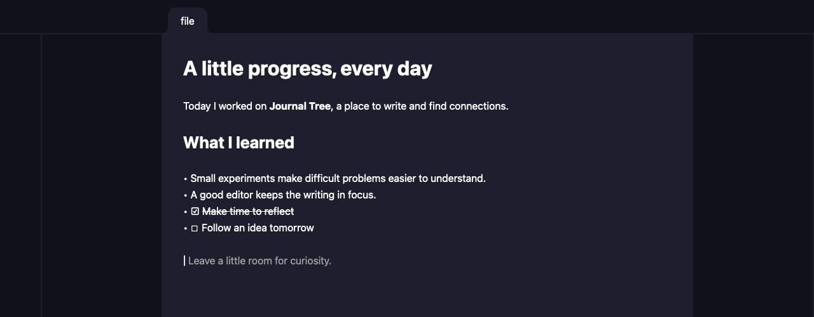

# Journal Tree

A native Markdown journaling app exploring how local topic modeling can turn everyday writing into a tree of related ideas.

Journal Tree is a personal engineering project inspired by Obsidian. The goal is to let people write freely and discover connections across their entries without manually organizing every note. It combines a Svelte 5 interface, GPU-accelerated native rendering through GPUI, a custom Rust Markdown editor, and a Python topic-modeling service.


## What works today

- Live Markdown editing
- Rich document rendering
- Local backend prototype: Python backend that exposes BERTopic endpoints locally

## Engineering focus

The main challenge is keeping an editable Markdown source and its formatted display in sync. Hiding delimiters changes text offsets, which affects cursor movement, selection, syntax highlighting, and Unicode handling. The Rust extension maps between source and display positions while retaining the underlying Markdown.

The interface renders directly into a native GPUI window through gpuix-svelte. Svelte manages the UI and reactive state. Rust handles Markdown projection and editor behavior. This provides a way to explore native text editing beyond a browser-based editor.

Files are read and decoded on a background thread. At 1 MiB or 5,000 lines, the worker also builds a Ropey buffer and hands it to the native editor. Large files stay editable in plain-text mode. The editor lays out rows near the viewport, scrolls long lines horizontally, and reuses the same buffer when switching tabs.

Files open on the first line. Scrollbars appear when content extends below or to the right of the editor. Drag a thumb or click its track to jump to a different position.

The native build pins its GPUIX and Zed source revisions, applies the project's textarea patch, and builds the extension with a project-local Rust toolchain.

The Python service runs as a child process piped into the GPUI process. Unfortunately not using any BERTopic right now (not implemented yet!), and it still needs to download the models --- not entirely local just yet.

## Run locally

Drag anywhere on the app's menubar to move the window. The native window
buttons still work normally. The menubar uses the local GPUIX extension
`window-drag: move` in `App.svelte`.

You will need:

- Node.js 24+
- Python
- Git and native build tools

```bash
git clone https://github.com/craigcontreras/journal-tree.git
cd journal-tree
npm ci

python3 -m venv .venv
.venv/bin/python -m pip install -r requirements.txt

npm run native:build
npm start
```

## Tests and development commands

After building the native extension, run:

```bash
npm run typecheck
npm run native:test
npm test
```
